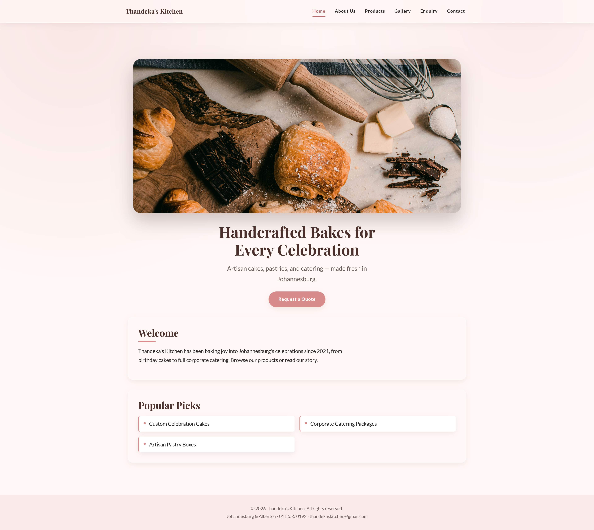
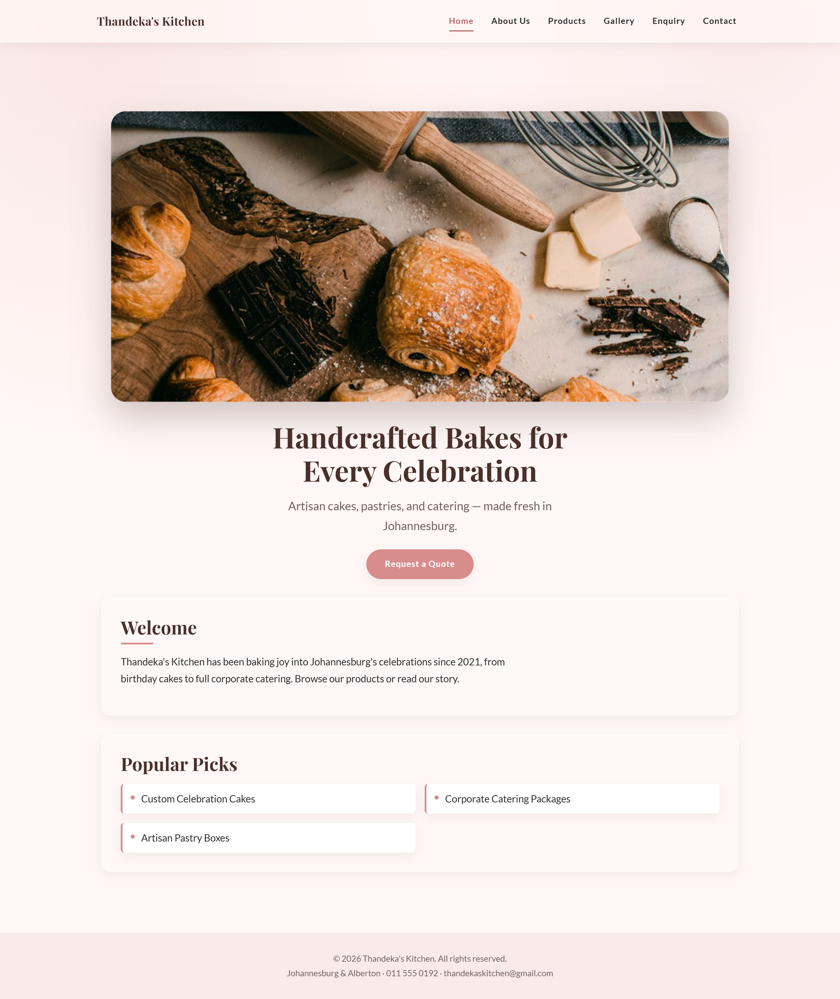
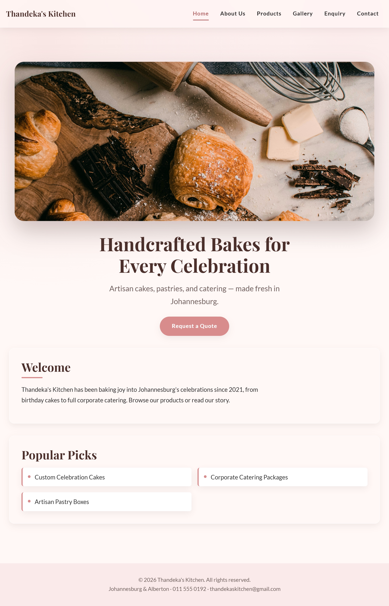
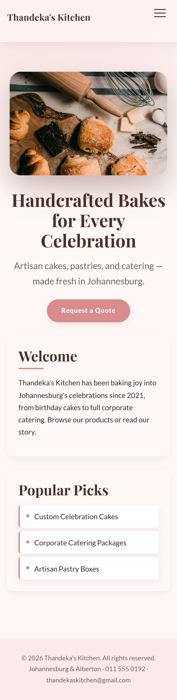
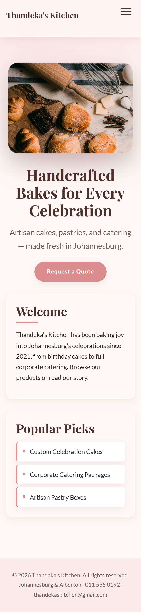

# Thandeka's Kitchen — Website Project

**Module:** WEDE5020 — Web Development (Introduction)
**Institution:** The Independent Institute of Education (IIE)
**Student:** Phuluso
**Student number:** ST10462787
**Repository:** https://github.com/Phuluso-11/thandekas-kitchen
**Current submission:** Part 2 — Designing the Visuals (CSS Styling and Responsive Design)

---

## 1. Project Overview

Thandeka's Kitchen is a Johannesburg-based artisan bakery and catering business, founded in 2021 by Thandeka Mokoena. The business grew from a home kitchen into a small commercial operation supplying custom celebration cakes, artisan pastries and corporate catering. It currently trades through Instagram and WhatsApp Business and has no website, which means no central menu, no portfolio of past work and no way to capture enquiries outside business hours.

This project delivers a six-page marketing website that presents the product range, shows evidence of past work, and channels visitors into an enquiry form.

## 2. Website Goals and Objectives

- Generate catering and custom-order leads through the enquiry form.
- Showcase products visually to build trust with new customers.
- Reduce repetitive WhatsApp and telephone queries by publishing pricing and product detail.

**Key performance indicators**

| KPI | Target |
|---|---|
| Enquiries received per month | 20+ within three months of launch |
| Average session duration | Above 90 seconds |
| Traffic growth | 15% month on month |

**Target audience:** working professionals aged 25–45 planning celebrations; small businesses ordering corporate catering; families ordering custom cakes.

## 3. Key Features and Functionality

| Page | File | Contents |
|---|---|---|
| Home | `index.html` | Hero image, tagline, welcome introduction, popular products, call to action |
| About Us | `about.html` | Founder story and portrait, mission, vision, team |
| Products | `products.html` | Three product categories with ZAR pricing |
| Gallery | `gallery.html` | Six-image responsive grid of past bakes and events |
| Enquiry | `enquiry.html` | Quote request form (name, email, phone, enquiry type, details) |
| Contact | `contact.html` | Two trading locations, phone, email, map placeholder, message form |

## 4. Sitemap

```
                        index.html (Homepage)
                                 |
   +-----------+-------------+---+-------+-------------+------------+
about.html  products.html  gallery.html  enquiry.html  contact.html
```

Flat, single-level hierarchy. All six pages are reachable from the main navigation on every page.

## 5. File and Folder Structure

```
thandekas-kitchen/
├── index.html
├── about.html
├── products.html
├── gallery.html
├── enquiry.html
├── contact.html
├── css/
│   └── style.css          Part 2: complete external stylesheet
├── js/
│   └── script.js          stub — JavaScript follows in Part 3
├── images/
│   └── gallery/           hero, founder and six gallery images (+ -800 copies)
├── tools/
│   └── resize-images.ps1  generates the 800px image copies used by srcset
├── docs/
│   ├── Proposal_ThandekasKitchen.docx
│   ├── sitemap.png
│   ├── wireframe-homepage.png
│   ├── sources.md
│   └── screenshots/       responsive testing evidence (see section 8)
└── README.md
```

---

## 6. Part 1 — Building the Foundation (submitted)

Two project proposals were submitted for lecturer approval and Thandeka's Kitchen was approved. Part 1 delivered the approved proposal document, six semantic HTML5 pages, a working navigation system, the sitemap and low-fidelity wireframe, the initial README and reference list, and the Git repository with descriptive commits. Colours were applied through inline `style` attributes at this stage because CSS had not yet been covered in class.

## 7. Part 2 — Designing the Visuals (this submission)

### 7.1 Stylesheet architecture

All styling lives in a single external stylesheet, `css/style.css`, linked from all six pages. The file is ordered so that the cascade does the work and the selector count stays low:

1. **CSS reset** — normalises `box-sizing`, margins, padding, list styles and form typography across browsers.
2. **Custom properties** — the whole brand (colours, type scale, spacing scale, radii, shadows, easing, layout widths) is declared once on `:root`, so a palette change is a one-line edit.
3. **Base styles** — body, headings, paragraphs, focus rings, selection colour, the shared `main` wrapper.
4. **Components** — header and navigation, buttons, hero, content panels, gallery grid, forms, map placeholder, footer.
5. **Media queries** — mobile-first breakpoints at 40em, 56.25em and 75em.
6. **Accessibility and print** — reduced-motion, high-contrast and print rules.

### 7.2 Colour scheme

| Token | Value | Use |
|---|---|---|
| `--clr-blush` | `#FBEAEA` | Footer background, map placeholder |
| `--clr-cream` | `#FFF8F6` | Page background |
| `--clr-rose` | `#D98C8C` | Accent: buttons, bullets, borders |
| `--clr-rose-deep` | `#B96A6A` | Hover and focus states (raises contrast) |
| `--clr-cocoa` | `#4A2F2A` | Headings |
| `--clr-ink` | `#2B2B2B` | Body text |

The palette is the one approved in the Part 1 proposal, extended with two darker tones so that interactive states meet WCAG AA contrast against the cream background.

### 7.3 Typography

Playfair Display (500/700) for headings and Lato (400/700) for body text, loaded from Google Fonts with system serif and sans-serif fallbacks. Sizes follow a 1.25 modular scale expressed entirely in `rem`, so the site scales with the visitor's own browser font-size setting. Body line-height is 1.7 and paragraphs are capped at 68 characters (`--measure`) for comfortable reading.

### 7.4 Layout

- **Flexbox** positions the header (`.header-inner`) and the horizontal navigation bar.
- **CSS Grid** builds the gallery (`.gallery-grid`), the product and featured lists, the two-column form rows, and the named-area layout of the About page story block (`grid-template-areas`).
- A single `main` rule centres and pads every page, so no page carries layout code of its own.

### 7.5 Advanced visual techniques (and what each is for)

| Technique | Where | Purpose |
|---|---|---|
| `backdrop-filter: blur()` | Sticky header, content panels | Frosted glass so the header stays legible over scrolling photography |
| `filter: blur()` | `.hero-media::after` | Warm rose glow under the hero image, suggesting an oven's heat |
| `perspective` + `rotateX` / `rotateY`, `transform-style: preserve-3d` | Hero image, gallery tiles | The hero reads as a tray tilting towards the viewer and settles flat on hover; gallery tiles lift and tilt, alternating direction on even tiles |
| `@keyframes` (`hero-rise`, `fade-up`) | Homepage load | One orchestrated entrance sequence on the homepage only, rather than scattered animation on every section |
| `box-shadow` depth scale | Panels, buttons, images | Three shadow tokens encode hierarchy: resting, lifted, elevated |
| Pseudo-elements | Nav underline, heading rules, list bullets, hamburger bars | Decoration without extra markup |

### 7.6 Pseudo-classes used

`:hover`, `:focus`, `:focus-visible`, `:active`, `:checked` (the CSS-only mobile menu), `:required`, `:valid`, `:empty`, `:nth-child`, `:nth-of-type`, `:focus-within` and `::selection`. Every interactive element — nav links, buttons, list items, form fields, gallery images — has a visible hover state *and* a visible keyboard focus state.

### 7.7 Responsive design

Mobile-first. The base rules are the phone layout; three `min-width` media queries progressively enhance it.

| Breakpoint | Width | Main adjustments |
|---|---|---|
| Base | up to 639px | Single column; collapsible hamburger menu; gallery one across; 240px hero |
| `40em` | 640px+ | Two-column gallery and product lists; larger padding; 340px hero |
| `56.25em` | 900px+ | Hamburger replaced by horizontal nav with animated underline; three-column gallery; About page becomes text-beside-image; mission and vision side by side; two-column forms; 440px hero |
| `75em` | 1200px+ | Larger base font size; wider gutters; 520px hero; panel hover lift |

**Navigation:** below 900px the menu collapses behind a 44px hamburger button built with a hidden checkbox and a label — no JavaScript, which keeps Part 2 CSS-only. The bars animate into a close icon when open.

**Typography:** font sizes are all `rem` values from the shared scale, and `--fs-base` itself increases at the desktop breakpoint, so every text element rescales together.

**Images:** `max-width: 100%` and `object-fit: cover` on all images; the hero and founder portraits use `<picture>` with a `media`-based `<source>`; gallery images use `srcset` with `w` descriptors and a `sizes` attribute so phones download the 800px file instead of the full-size one. `tools/resize-images.ps1` generates those smaller copies.

**Accessibility:** skip link on every page, `aria-current="page"` on the active nav item, descriptive `alt` text, visible focus rings, `prefers-reduced-motion` and `prefers-contrast` support, and touch targets of at least 44px.

## 8. Responsive Testing Evidence

Tested in Google Chrome, Microsoft Edge and Mozilla Firefox using Chrome DevTools device emulation.

| Device / viewport | Screenshot |
|---|---|
| Desktop — 1920 × 1080 | `document/screenshots/desktop-1920.png` |
| Laptop — 1366 × 768 | `document/screenshots/laptop-1366.png` |
| Tablet — iPad Air, 820 × 1180 | `document/screenshots/tablet-ipad-air.png` |
| Mobile — iPhone 14 Pro, 393 × 852 | `document/screenshots/mobile-iphone-14.png` |
| Mobile — Samsung Galaxy S20 Ultra, 412 × 915 | `document/screenshots/mobile-galaxy-s20.png` |

### Responsive screenshots (Part 2)







## 9. Timeline and Milestones

| Weeks | Milestone | Status |
|---|---|---|
| 1–2 | Proposals, approval, research, sitemap | Complete |
| 3–5 | HTML structure and content across six pages | Complete (Part 1) |
| 6–8 | CSS styling and responsive design | Complete (Part 2) |
| 9–10 | JavaScript, SEO, forms, deployment | Part 3 |

---

## 10. Changelog

### [Part 2] — 2026-09-16

**A. Changes made in response to Part 1 feedback**

Part 1 was graded 91/100 (Level 4). The lecturer's written feedback on the LMS reads in full: *"Excellent work!!"* No corrective comments were attached to individual rubric criteria, and the detailed graded rubric could not be opened on the LMS to check for further line-level comments. On that basis, no specific errors were flagged for correction. The changes below were made proactively during the Part 2 build, to strengthen the site ahead of requirements rather than in response to named faults.

- **Inline styling removed (a Part 2 requirement; Part 1 used it because CSS had not yet been covered in class).** All `style` attributes were deleted from `index.html`, `about.html` and `gallery.html` and rebuilt as reusable classes in `css/style.css`. The HTML now carries structure only.
- **Logo converted to a link (self-identified).** The site name was a non-interactive `<div>`; it is now an `<a>` linking to the homepage.
- **Skip link and navigation labelling added (self-identified).** A "Skip to main content" link and `aria-label`/`aria-current` were added so keyboard and screen-reader users can navigate the site properly.

**B. Structural and semantic improvements**

- Converted the logo from a non-interactive `<div>` to an `<a>` linking to the homepage, so the site name works the way visitors expect.
- Wrapped the header contents in `.header-inner` and added `class="site-header"`, `class="site-nav"` and `class="site-footer"` so the stylesheet can target them without relying on element selectors alone.
- Added `aria-label="Main navigation"` to each `<nav>` and `aria-current="page"` to the active link.
- Added a "Skip to main content" link and `id="main-content"` on `<main>` for keyboard users.
- Added a `meta name="description"` to all six pages, and turned the contact page's phone number and email address into `tel:` and `mailto:` links.
- Added `autocomplete` attributes to the name, email and phone fields on both forms.
- Emptied the map placeholder `<div>`; the label now comes from CSS and will disappear automatically when the Part 3 embed is added.

**C. CSS styling (new in Part 2)**

- Created `css/style.css` and linked it from all six pages.
- Added a CSS reset and a default style layer (font family, base size, line height, colour scheme, spacing).
- Declared the full design system as CSS custom properties on `:root`: six brand colours, two font stacks, an eight-step type scale, a six-step spacing scale, three border radii, three shadow depths, and shared easing and layout tokens.
- Implemented the Playfair Display and Lato pairing from the proposal, with a 1.25 modular type scale in `rem`.
- Built the layout with Flexbox (header, navigation) and CSS Grid (gallery, product lists, form rows, About page named grid areas).
- Applied decorative styling: shadow depth scale, rose accent borders and dividers, rounded panel geometry, and pseudo-element bullets and underlines.
- Added the advanced treatments listed in section 7.5: glass-morphism header and panels, blurred hero glow, 3D perspective transforms on the hero and gallery, and a single keyframed homepage entrance sequence.
- Styled every interactive state with `:hover`, `:focus`, `:focus-visible` and `:active`, plus `:checked`, `:valid` and `:required` on form controls.

**D. Responsive design (new in Part 2)**

- Rebuilt the site mobile-first with breakpoints at 40em (640px), 56.25em (900px) and 75em (1200px).
- Added the CSS-only hamburger navigation for viewports under 900px.
- Converted the gallery from a fixed inline grid to a responsive one-, two- and three-column grid.
- Made the forms single-column on phones and two-column from 900px, with full-width message fields.
- Added `<picture>` and `srcset`/`sizes` responsive images, plus `tools/resize-images.ps1` to generate the smaller image files.
- Added `prefers-reduced-motion`, `prefers-contrast` and print stylesheets.

### [Part 1] — 2026-08-14

- Created the project folder structure (`css`, `js`, `images`, `docs`).
- Built six HTML5 pages using semantic elements with explanatory comments throughout.
- Implemented the shared navigation across all pages and tested every link.
- Sourced and added images, the sitemap diagram and the homepage wireframe.
- Wrote the project proposal, README and `sources.md`.
- Initialised Git, committed the project and pushed to GitHub.
- Fixed an HTTP 408 push failure with `git config http.postBuffer 524288000`.

---
### Feedback from Part 2 (75%)
The written feedback and graded rubric for Part 2 were not available to me at the time of this submission, so I could not respond to specific lecturer comments. Instead I re-read the Part 2 rubric and reviewed my own work against it, and made these improvements. 

| Change | Reason |
|---|---|
| Renamed gallery, hero and founder images with descriptive names and updated every page | Clearer file naming; also supports image SEO |
| Applied the same complete meta block (title, description, keywords, canonical, social tags) to all six pages | Consistency across every page |
| Added a footer contact line and body-text links between pages | Easier navigation and consistent contact details |

Only list changes you actually made. Add these two rows **only if you do them**: "Added five device screenshots to the README (the Part 2 brief asks for screenshot evidence there)" and "Re-checked the reference list for consistent Harvard formatting".

### Part 3 development
| Date | Change |
|---|---|
| 2026-11-01 | Added `js/script.js` with form validation, enquiry quote, contact email, accordion, lightbox, map, dynamic products and scroll animation |
| 2026-11-01 | Added `data/products.json` holding all products, prices and lead times; products page now builds from it |
| 2026-11-01 | Wrapped every form field in a `.field` container to hold its error message; added `novalidate` so styled messages replace browser pop-ups |
| 2026-11-01 | Added Part 3 CSS (section 14): errors, result panels, product cards, accordion, lightbox, map, reveal animation |
| 2026-11-01 | Updated title tags, meta descriptions and keywords, canonical and Open Graph tags on all pages; added JSON-LD, `robots.txt`, `sitemap.xml` |
| 2026-11-01 | Renamed images with descriptive names (`tools/rename-images.ps1`) and updated all pages |
| 2026-11-01 | Added footer contact line and body-text internal links for navigation and local SEO |
| 2026-11-01 | Deployed to GitHub Pages |

Added five device screenshots to the README as required in the Part 2 brief

## 11. References

Anthropic, 2026. *Claude* [Large language model]. Available at: https://claude.ai [Accessed 16 September 2026].

Afrihost, 2026. *Web hosting plans*. [online] Available at: https://www.afrihost.com [Accessed 14 August 2026].

Coyier, C., 2026. *A complete guide to flexbox*. [online] CSS-Tricks. Available at: https://css-tricks.com/snippets/css/a-guide-to-flexbox/ [Accessed 16 September 2026].

Coyier, C., 2026. *A complete guide to CSS grid*. [online] CSS-Tricks. Available at: https://css-tricks.com/snippets/css/complete-guide-grid/ [Accessed 16 September 2026].

GitHub (2026) *GitHub Pages documentation*. Available at: https://docs.github.com/en/pages (Accessed: 1 November 2026).

Google, 2026. *Google Fonts: Lato and Playfair Display*. [online] Available at: https://fonts.google.com [Accessed 16 September 2026].

Google (2026) *Google Search Central documentation*. Available at: https://developers.google.com/search/docs (Accessed: 1 November 2026).

Leaflet (2026) *Leaflet quick start guide*. Available at: https://leafletjs.com/examples/quick-start/ (Accessed: 1 November 2026).

Mozilla, 2026. *backdrop-filter*. [online] MDN Web Docs. Available at: https://developer.mozilla.org/en-US/docs/Web/CSS/backdrop-filter [Accessed 16 September 2026].

Mozilla, 2026. *Responsive images*. [online] MDN Web Docs. Available at: https://developer.mozilla.org/en-US/docs/Web/HTML/Responsive_images [Accessed 16 September 2026].

Mozilla, 2026. *Using CSS custom properties (variables)*. [online] MDN Web Docs. Available at: https://developer.mozilla.org/en-US/docs/Web/CSS/Using_CSS_custom_properties [Accessed 16 September 2026].

Mozilla, 2026. *Using CSS transforms*. [online] MDN Web Docs. Available at: https://developer.mozilla.org/en-US/docs/Web/CSS/CSS_transforms/Using_CSS_transforms [Accessed 16 September 2026].

Mozilla (2026) *Fetch API*. MDN Web Docs. Available at: https://developer.mozilla.org/en-US/docs/Web/API/Fetch_API (Accessed: 1 November 2026).

Mozilla (2026) *Intersection Observer API*. MDN Web Docs. Available at: https://developer.mozilla.org/en-US/docs/Web/API/Intersection_Observer_API (Accessed: 1 November 2026).

OpenStreetMap Foundation (2026) *Tile usage policy*. Available at: https://operations.osmfoundation.org/policies/tiles/ (Accessed: 1 November 2026).

Schema.org (2026) *Bakery*. Available at: https://schema.org/Bakery (Accessed: 1 November 2026).

Unsplash, 2026. *Free stock photography*. [online] Available at: https://unsplash.com [Accessed 14 August 2026].

W3C, 2026. *Web Content Accessibility Guidelines (WCAG) 2.2*. [online] Available at: https://www.w3.org/TR/WCAG22/ [Accessed 16 September 2026].

W3C (2026) *Accordion pattern*. ARIA Authoring Practices Guide. Available at: https://www.w3.org/WAI/ARIA/apg/patterns/accordion/ (Accessed: 1 November 2026).

W3C (2026) *Dialog (modal) pattern*. ARIA Authoring Practices Guide. Available at: https://www.w3.org/WAI/ARIA/apg/patterns/dialog-modal/ (Accessed: 1 November 2026).

Xneelo, 2026. *Domain registration*. [online] Available at: https://www.xneelo.co.za [Accessed 14 August 2026].

## 12. AI Usage Disclosure

Anthropic's Claude was used for guidance on CSS structure, responsive breakpoint strategy and code review during Part 2 (Anthropic, 2026). All code was reviewed, tested and adapted by the student, and the design direction, colour palette and content are the student's own. Screen grabs of the AI interactions are included in the AI disclosure annexe submitted with this part, as required by the IIE guidelines.

## Part 3: Enhancing Functionality and SEO

**Live site:** <LIVE-URL>  |  **Repository:** https://github.com/Phuluso-11/thandekas-kitchen

### Part 3 features

| Feature | Where | How it works |
|---|---|---|
| Enquiry form validation | enquiry.html | `script.js` checks name, email, South African phone format, product, quantity (whole number 1 to 500), date (must meet the product's lead time) and message length (10 to 1000). Errors show beside each field and the first bad field receives focus. |
| Enquiry response (AJAX) | enquiry.html | After validation, `fetch()` loads `data/products.json`, calculates the estimated cost for the chosen product and quantity, checks availability against the lead time, and shows a summary with a reference number without reloading the page. |
| Contact form and email | contact.html | Validates name, email, optional phone, message type and message, then compiles a subject and body into a `mailto:` link addressed to thandekaskitchen@gmail.com. A preview is shown and the visitor presses Send in their email app. |
| Accordion | enquiry.html | FAQ with `aria-expanded`, one answer open at a time. |
| Gallery lightbox | gallery.html | Click or Enter opens the full-size photo; arrows, swipe, Escape and backdrop click supported; focus is trapped while open and returned on close. |
| Interactive map | contact.html | Leaflet with OpenStreetMap tiles, markers and popups for both locations, buttons that fly to each one, and a "Get directions" link. |
| Dynamic products, search, filter, sort | products.html | Product cards are built from `data/products.json`. Live search (name, description, keywords), category filter and sort by name or price. `?category=` and `?q=` links pre-fill the filters. |
| Animations | all pages | CSS keyframe fade-up on scroll (IntersectionObserver), card hover lift, lightbox fade, accordion open animation. Disabled automatically for `prefers-reduced-motion`. |

### SEO summary

| Page | Title tag | Main keywords |
|---|---|---|
| index.html | Artisan Bakery & Cakes in Johannesburg \| Thandeka's Kitchen | artisan bakery Johannesburg, celebration cakes, corporate catering |
| about.html | About Thandeka's Kitchen \| Johannesburg Artisan Bakers | Thandeka Mokoena, local bakery, handcrafted baking |
| products.html | Celebration Cakes, Catering & Pastries \| Thandeka's Kitchen | birthday cakes Johannesburg, wedding cakes, pastry platters |
| gallery.html | Cake & Pastry Gallery \| Thandeka's Kitchen Johannesburg | cake gallery, wedding dessert table |
| enquiry.html | Request a Cake or Catering Quote \| Thandeka's Kitchen | cake quote Johannesburg, catering quote |
| contact.html | Contact & Locations \| Thandeka's Kitchen Johannesburg | bakery Johannesburg address, Alberton pop-up kitchen |

- **Keyword research:** the phrases above combine the service (cakes, catering, pastries) with the location (Johannesburg, Alberton), because local customers search that way (Google, 2026). Keywords were checked against what a customer would type to find the products on the price list.
- **Meta keywords:** included on every page because the brief asks for them. Major search engines ignore this tag today (Google, 2026), so the on-page headings, title tags and descriptions carry the real SEO weight.
- **Titles and descriptions:** unique per page; titles about 55 to 60 characters, descriptions about 120 to 150 characters.
- **Headings:** one `h1` per page, then `h2` and `h3` in order.
- **Images:** descriptive file names (for example `two-tier-floral-celebration-cake-johannesburg.jpg`) and meaningful alt text; `loading="lazy"` and `srcset` keep pages fast.
- **Clean URLs and internal links:** short page names; products, enquiry, contact and about link to each other in the body text and footer; product cards deep-link to `enquiry.html?product=...`.
- **Local SEO:** name, address and phone repeated in the footer; `Bakery` structured data (JSON-LD) on the home page (Schema.org, 2026); two locations on the map.
- **robots.txt and sitemap.xml:** in the project root. Note that crawlers only read `robots.txt` at a domain's root; on a GitHub Pages project address it documents intent but is not enforced.
- **Mobile-friendliness:** viewport tag, mobile-first CSS, 44px touch targets, responsive images.
- **Page speed:** deferred script, lazy images, resized `-800` copies, single CSS and JS file, Leaflet loaded only on the contact page.
- **Security:** all visitor input is written to the page with `textContent` (never `innerHTML`); Leaflet files use Subresource Integrity hashes; external links use `rel="noopener noreferrer"`; a strict referrer policy is set; no secrets or server code in the repository.
- **Off-page SEO (plan, not code):** list the business on Google Business Profile for both addresses, share the site on Facebook and Instagram using the Open Graph tags already added, and ask local suppliers and event venues for links back to the site. These cannot be completed on a fictional business, so they are documented as the recommended next steps.

### Deployment (GitHub Pages)

1. Push `main` to GitHub.
2. Repository **Settings > Pages > Build and deployment**: Source "Deploy from a branch", branch `main`, folder `/ (root)`, Save.
3. Wait one to two minutes and open the live address. Test every page (see the testing note below).

### Testing note

| Test | Result |
|---|---|
| Enquiry: submit empty form | 5 errors shown, focus moves to the first |
| Enquiry: invalid phone (12345), past date, short message | Specific message beside each field |
| Enquiry: valid birthday cake x2 for a future date | Summary shows "From R900", lead-time availability message, reference number |
| Enquiry: product changed to Wedding Cake with a date 3 days away | Date error: 14 days' notice needed |
| Enquiry: "Other" type | Product and quantity hidden and skipped |
| Contact: valid message | Preview panel shown and email app opens with subject, body and recipient filled in |
| Products: search "bread", sort by price, category filter | Correct cards, count updates, empty state offers a reset |
| Gallery: click, Enter, arrows, Escape, swipe | Opens, moves, closes, returns focus |
| Map: markers, popups, buttons | Both locations shown; buttons zoom to each |
| Responsive: 1920, 1366, 820, 393, 412 px | No horizontal scrolling; hamburger works below 900px |
| Browsers | Chrome and Edge (add Firefox if you test it) |